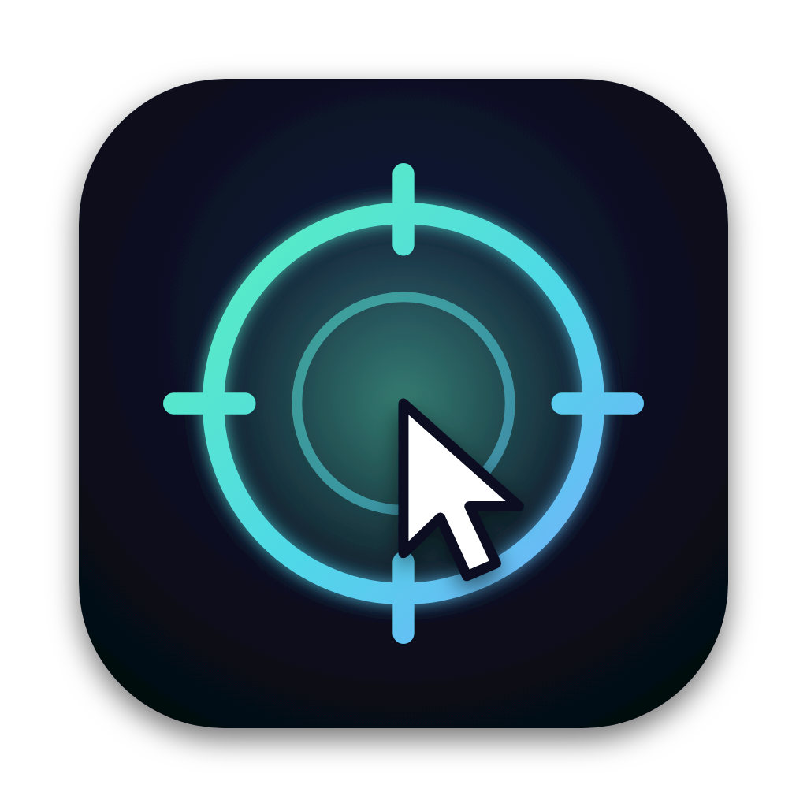

# AimMac for Android

Turn an **Android phone** into a pointer for your Mac. Aim it at the screen to move the cursor, tap to click, hold to drag. It works like the iPhone app in [AimMac](https://github.com/Coolerwave/AimMac) and talks to the same Mac receiver, so nothing changes on the Mac.

No Wi-Fi and no servers: the phone talks straight to the Mac over Bluetooth.

> Status: new and experimental. It was written for the Solana Seeker (Android 14) and should work on any Android 8+ phone with Bluetooth LE and a gyroscope.

## What it does

- **Point like a laser.** The cursor goes where the top edge of the phone points. Up/down comes from gravity, so it never drifts.
- **Tap** to click, **hold** to drag, a **right-click** button, and a scroll strip.
- **Trackpad mode.** Lay the phone on the table and slide a finger, with a drag lock for moving windows.
- **Center** re-aims the middle of the screen. **Pause** frees the cursor for your real trackpad.
- **Pairing with approval.** The first time, the Mac asks you to allow the phone.

## Setup

1. Install and run the **Mac receiver** from [AimMac](https://github.com/Coolerwave/AimMac) (the `Mac` folder, `./build.sh run`). Allow Bluetooth and Accessibility.
2. Get the app (pick one):
   - Download `AimMac-Android.apk` from the [Releases](../../releases) page, or from the latest run in the **Actions** tab (Artifacts), and open it on the phone. Android will ask you to allow installs from your browser or file manager.
   - Or build it: open this folder in Android Studio and press Run, or `./gradlew assembleDebug` (the APK ends up in `app/build/outputs/apk/debug/`).
3. Open AimMac on the phone and allow **Nearby devices** (Bluetooth). Tap **Pair** next to your Mac, then click **Allow** on the Mac.
4. Hold the phone like a remote, top edge toward the screen, aim at the middle of the screen and tap **Center**.

## How it works

The phone sends the same small packets as the iPhone app (`Protocol.kt` mirrors `Shared/Protocol.swift`): a hello, aim samples at about 100 Hz (azimuth and elevation in degrees), press, release, right click, scroll and move. The gyroscope gives the turn around the true vertical (left/right), gravity gives the tilt (up/down), same maths as `MotionAim` on iOS. The Mac does the rest: smoothing, freezing the cursor on a press, and clicking where you were aiming.

## Files

- `MotionAim.kt` gyroscope and gravity into azimuth and elevation
- `MacLink.kt` Bluetooth LE: scan, pair, reconnect, write queue
- `PointerSession.kt` glue between the two, click and drag logic
- `MainActivity.kt`, `Pads.kt`, `Ui.kt` the screens

## License

MIT, see [LICENSE](LICENSE).
