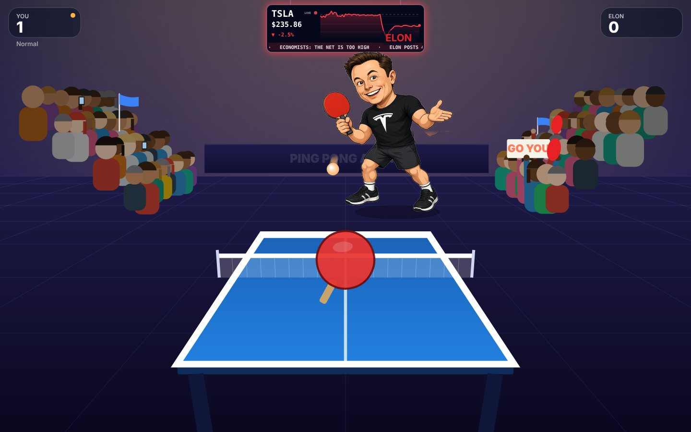
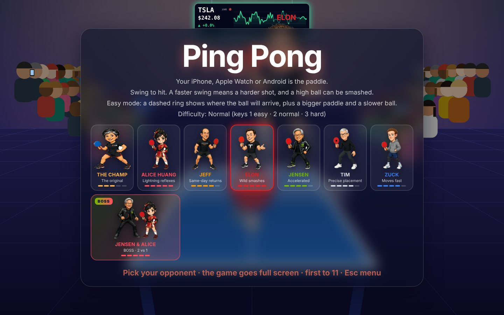
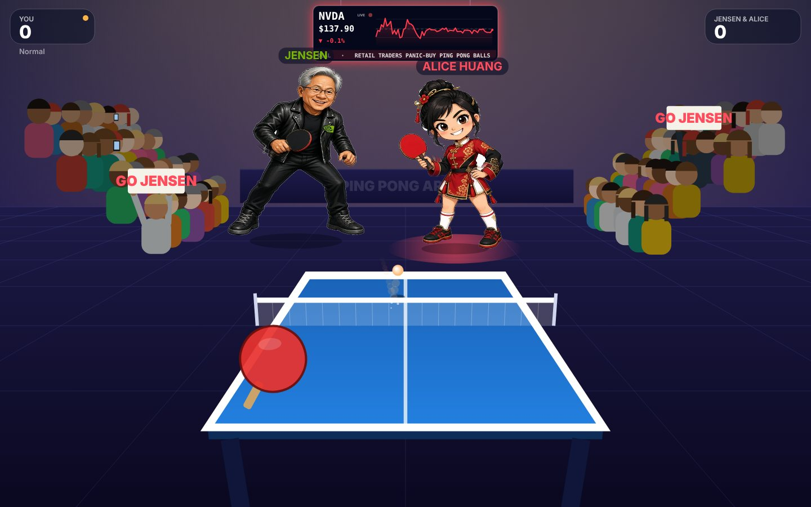
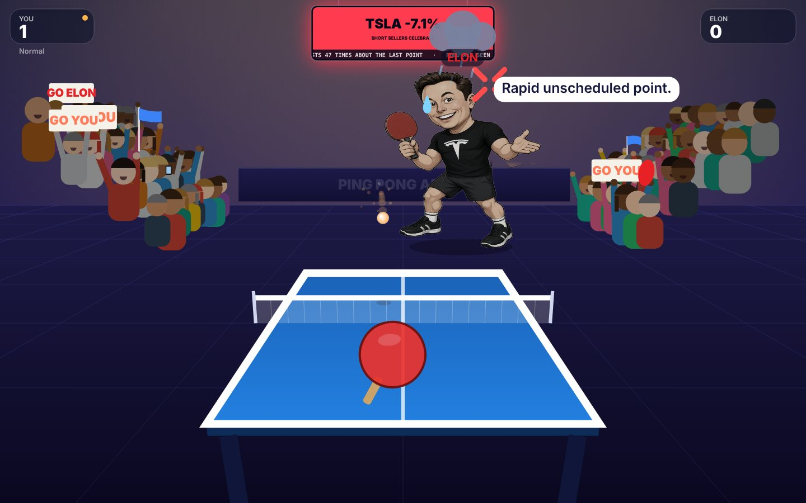
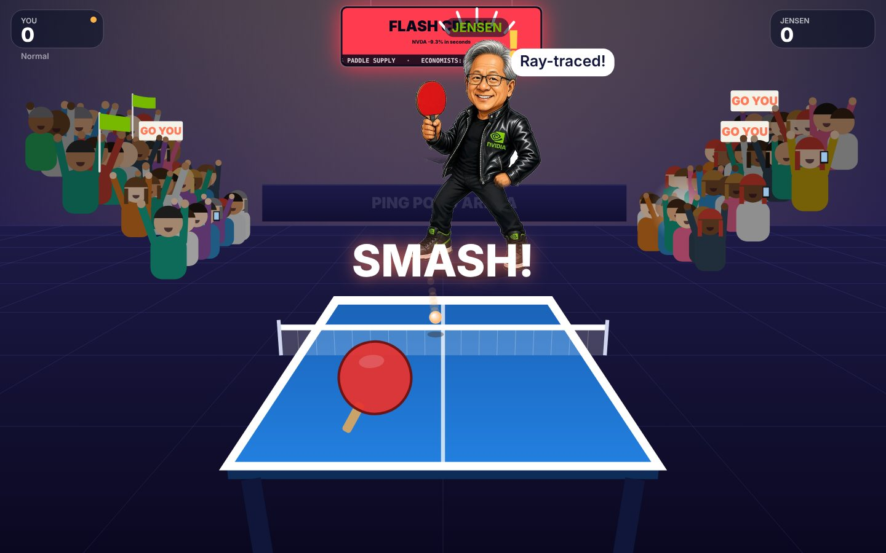
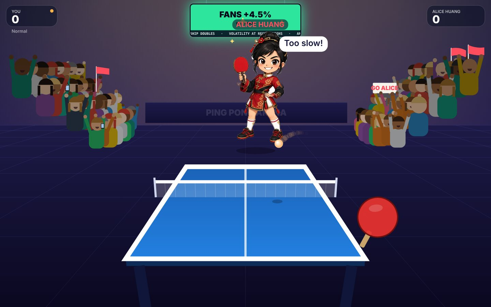

# Ping Pong

A one-page table tennis game for the browser, made to show off [AimMac](https://github.com/Coolerwave/AimMac). Your iPhone, Apple Watch or Android phone is the paddle: AimMac moves the Mac cursor where you aim, and the game follows the cursor.

**Play it here:** https://coolerwave.github.io/AimMac/PingPong/

It also works with a normal mouse or trackpad.

## How to play

1. Start the AimMac receiver on the Mac and connect your phone or watch.
2. Open the game in a browser and press **F** for full screen.
3. Pick an opponent, then click to serve.
4. Aim to move the paddle and swing to hit. A faster swing means a harder shot, and a high ball can be smashed.

First to 11, win by 2.

## Opponents

Seven opponents, each with their own speed, power, shot placement, celebrations and trash talk: The Champ, Alice Huang, Jeff, Elon, Jensen, Tim and Zuck.

They move around the table, switch between forehand, backhand, lunge and ready stances, jump for high balls, stretch for the ones they miss, and sulk under a rain cloud when you score.

**Boss: Jensen & Alice.** A doubles team, two against you. Like real doubles they hit in turn: one returns, steps aside, and the partner takes the next ball. A glow under their feet shows whose turn it is.

## The stock market screen

Every opponent has a ticker on the big screen above the court. When they score on you their stock pumps, when they miss it dumps. Three points in a row trigger a bull run or a trading halt, a smash causes a flash crash, and the match ends with TO THE MOON or MARGIN CALL. Prices and headlines are made up for fun.

| Elon misses, TSLA crashes | Smash, flash crash | Alice scores, fans pump |
| --- | --- | --- |
|  |  |  |

## Keys

| Key | What it does |
| --- | --- |
| Click or Space | Start, serve, play again |
| 1 / 2 / 3 | Easy / Normal / Hard |
| F | Full screen |
| Esc | Back to the opponent menu |

**Easy** gives a bigger paddle, a slower ball and a dashed ring that shows where the ball will arrive.

## Notes

- One HTML file, no build step and no dependencies. Download `index.html` and open it, or use the link above.
- Your opponent, difficulty and best winning margin are saved in the browser.
- Add `?auto` to the address for a demo where the game plays itself, and `?opp=elon` (or `alice`, `jeff`, `jensen`, `tim`, `zuck`, `champ`, `boss`) to jump straight to an opponent.
- The characters are cartoon parodies. This is a fan project and is not affiliated with or endorsed by any of the people or companies it pokes fun at.

## License

MIT, same as [AimMac](https://github.com/Coolerwave/AimMac).
